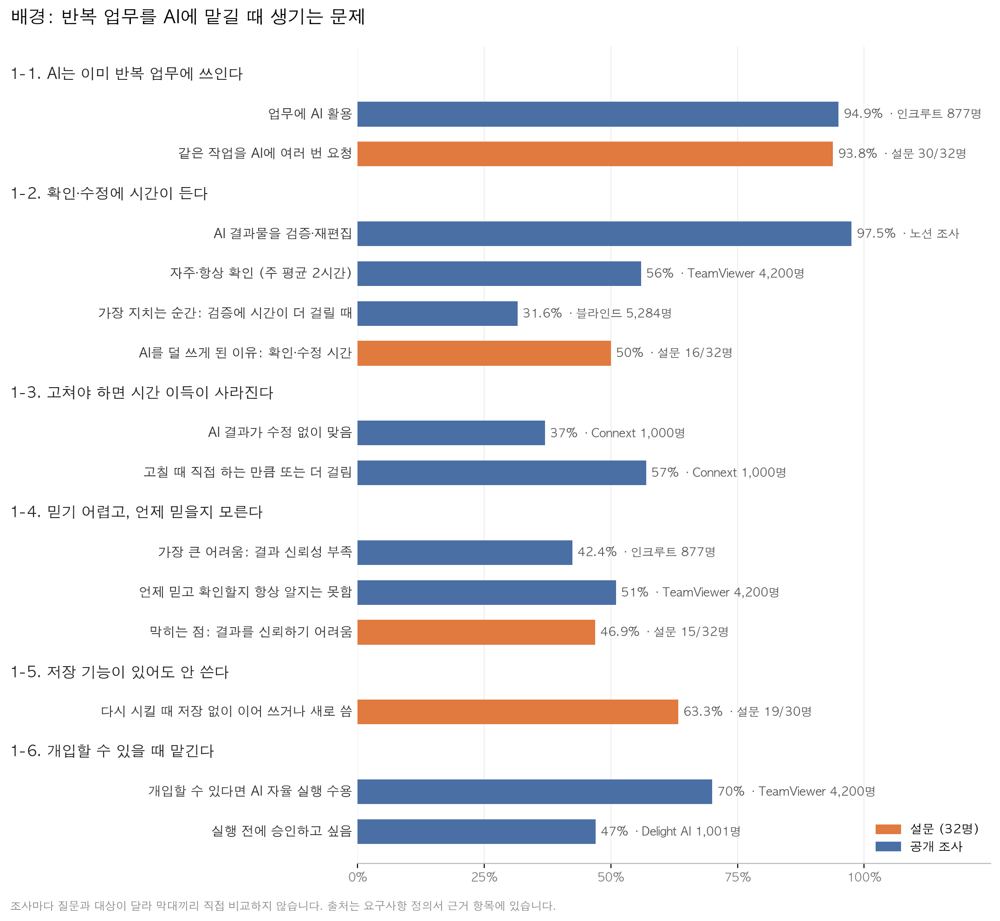

# 요구사항 정의서 (개정판)

작성일: 2026-10-09
앱: `app/` (React + Vite + Tailwind, Vercel 배포, Gemini 무료 API, PC 웹)
구성: 제출 양식 순서(프로젝트 이름 / 문제 정의 / 근거 / 해결 방안 / 제작 회고)를 따릅니다. 기능 상세, 데이터 구조, AI 호출 방식은 [화면·기능 정의서](screen-spec.md)에 있습니다.

---

## 1. 프로젝트 이름

**또시켰네**

> 다른 AI는 결과를 만들어 주고, 또시켰네는 그 일을 믿고 맡겨도 되는지 알려줍니다.

---

## 2. 문제 정의

> 반복 업무를 AI에 맡기는 사람들은 결과를 믿지 못해 매번 전체를 확인하고 고칩니다. 고쳐야 하면 시간 이득이 사라지고, 다음에도 같은 설명과 수정을 반복합니다. 그래서 AI에게 믿고 맡길 수 있는 상태에 이르지 못합니다.

| 구분 | 내용 |
| --- | --- |
| 대상 | 매주 같은 형식의 문서(주간보고, 회의록, 자료 요약)를 AI로 쓰면서, 대화방에 이어 쓰거나 매번 새로 설명하는 사람 |
| 대상 아님 | GPTs·프로젝트에 지시문을 직접 써서 관리하는 사람, 맡길 일을 몰라서 막힌 사람 |
| 다루지 않는 것 | AI 결과의 정확도 자체. 정확도는 모델을 만드는 회사의 영역입니다. |

---

## 3. 근거

### 3-1. 문제가 있다는 근거

차트의 숫자를 문제 순서대로 읽으면 이렇습니다.

1. **반복 업무에 AI를 쓴다.** 직장인 94.9%가 업무에 AI를 쓰고, 설문 응답자 30/32명이 같은 작업을 여러 번 요청해봤습니다.
2. **결과를 확인하고 고치는 데 시간이 든다.** 97.5%가 AI 결과물을 검증·재편집하고, 56%는 자주·항상 확인하며 주 평균 2시간을 씁니다. 설문에서도 절반(16/32명)이 확인·수정 시간 때문에 AI를 계속 쓰지 않게 됐다고 답했습니다.
3. **고쳐야 하면 시간 이득이 사라진다.** 수정 없이 맞는 경우는 37%이고, 고쳐야 할 때 직접 하는 것과 시간이 같다는 응답이 46%, 더 걸린다는 응답이 11%였습니다. 설문에서는 14/32명이 매번 수정해야 했다고 답했습니다.
4. **언제 믿어야 할지 모른다.** 결과 신뢰성 부족이 가장 큰 어려움(42.4%)이고, 51%는 언제 믿고 언제 확인할지 항상 알지는 못합니다. 설문에서 AI를 쓸 때 막히는 점으로 가장 많이 고른 것도 결과를 신뢰하기 어렵다는 것(15/32명)이었습니다.
5. **저장 기능이 있어도 해결되지 않는다.** 같은 작업을 다시 시킬 때 30명 중 19명은 저장 없이 이어 쓰거나 새로 쓰거나 예전 내용을 찾아 복사합니다. OpenAI도 맞춤 지시·프로젝트 같은 기능은 파워 유저 위주로 쓰이고 설정 부담이 장벽이라고 밝혔습니다.
6. **개입할 수 있을 때 맡긴다.** 61%는 AI가 스스로 행동하지 않기를 원하지만, 개입할 수 있다면 70%가 자율 실행을 받아들입니다.

사용자 글에서도 같은 문제가 보입니다. 골라 온 사례라 비율로 해석하지 않습니다.

- "맞춤 지시를 넣어도 무시해서 질문할 때마다 같은 지시를 붙여야 한다." [OpenAI 커뮤니티](https://community.openai.com/t/chatgpt4o-ignoring-prompts-in-instructions-box/1110078)
- "고치면 알겠다고 하고 잠깐 잘하다가 같은 실수가 다시 돌아온다." [OpenAI 커뮤니티](https://community.openai.com/t/goldfish-memory-gpt-5-6-local-intelligence-is-high-but-longitudinal-intelligence-has-become-unreliable/1401345)
- "정말 맞나 싶어 다시 확인하느라, 직접 쓰면 40분이면 끝날 일이 1시간 걸린다." [잡코리아](https://www.jobkorea.co.kr/recruit/careers/articles/ai-burnout-solution)
- "결과를 바로 확인하기 힘든 예약 실행을 시킬 정도로는 AI를 신뢰하지 못한다." (설문 주관식)
- "완전히 똑같은 내용을 복사하는 게 아니라, 복사한 다음 약간 고쳐야 해서 자동화하지 않았다." (설문 주관식)

### 3-2. 해결 방향의 근거

| 해결 방향 | 근거 | 근거 수준 |
| --- | --- | --- |
| 근거를 보여주면 확인할 곳이 줄어든다 | 설명을 보여주면 더 믿을 만한 응답을 고른 비율이 2배 (165/300 대 84/300). 단, 틀린 근거는 신뢰를 낮춘다 | 실험 환경 |
| 고친 내용을 기준으로 쌓으면 덜 고친다 | 사용자 수정에서 기준을 뽑아 다음 생성에 쓰면 수정량 31~73% 감소 | 시뮬레이션 |
| 수정 기록이 쌓이면 맡기는 부담이 준다 | 언제 믿을지 모름 51%, 개입할 수 있으면 자율 수용 70% | 간접 근거만 |

### 3-3. 출처

| 출처 | 조사 주체·대상 | 쓴 곳 |
| --- | --- | --- |
| 설문 「일상과 업무에서 반복되는 일, 어떻게 처리하고 있나요」 | 직접 진행, 2026.10.07~09, 32명 | 3-1 |
| [인크루트](https://news2day.co.kr/article/20260514500103) | 인크루트, 직장인 877명, 2026.04~05 | 3-1 |
| [노션 조사](https://www.epnc.co.kr/news/articleView.html?idxno=328100) | 노션, 한국 직장인 | 3-1 |
| [TeamViewer](https://www.prnewswire.com/news-releases/teamviewer-study-75-of-employees-use-ai-daily-but-61-want-human-oversight-indicating-a-confidence-gap-limiting-progress-302831545.html) | TeamViewer, 10개국 4,200명, 2026.07 발표 | 3-1, 3-2 |
| [블라인드 (잡코리아 인용)](https://www.jobkorea.co.kr/recruit/careers/articles/ai-burnout-solution) | 중앙일보 팩플, 블라인드 직장인 5,284명 | 차트 |
| [Connext](https://connextglobal.com/the-connext-global-2026-ai-oversight-report/) | Connext, 미국 1,000명, 2026.01 | 3-1 |
| [Delight AI](https://delight.ai/blog/industry/human-in-the-loop-ai) | Delight AI, 미국 1,001명, 2026 | 차트 |
| [OpenAI 업무 사용 패턴](https://openai.com/business/guides-and-resources/chatgpt-usage-and-adoption-patterns-at-work/) | OpenAI | 3-1 |
| [arXiv 2601.14460](https://arxiv.org/pdf/2601.14460), [arXiv 2603.07306](https://arxiv.org/pdf/2603.07306) | 근거 표시와 신뢰 사용자 연구 | 3-2 |
| [arXiv 2404.15269](https://arxiv.org/abs/2404.15269) | Microsoft Research, NeurIPS 2024 | 3-2 |

### 3-4. 근거의 한계

- 설문 응답자 대부분이 AI에 익숙한 부트캠프 동기라 공개 조사로 보완했습니다.
- TeamViewer, Delight AI는 자사 서비스와 관련된 조사이고, 해외 조사가 많습니다.
- 블라인드 31.6%는 잡코리아 기사 인용으로만 확인했고 원문은 아직 찾지 못했습니다.
- 설문의 "가장 필요한 기능" 문항에서는 "맡길 반복 업무를 찾아주는 기능"이 15/32명으로 가장 많았습니다. 다만 이 문항의 선택지는 처음 방향(찾기·등록·자동 실행) 기준이라 현재 해결 방안과 직접 비교할 수 없고, 실제로 막히는 점에서 "맡길 일을 모르겠다"를 고른 사람은 4/32명이었습니다.
- 저장 기능을 안 쓰는 이유와, 고치는 내용이 형식인지 정확성인지는 설문에서 묻지 않았습니다. 사용성 테스트에서 확인합니다.

---

## 4. 해결 방안

### 4-1. 흐름

사용자는 프롬프트를 쓰지 않습니다. 업무를 설명하고, 결과를 확인하고, 고치기만 합니다.

| 단계 | 사용자가 하는 것 | 서비스가 하는 것 |
| --- | --- | --- |
| 등록 | 질문 4개에 답한다 (무슨 일 / 자료 / 결과 모양 / 예전에 잘 나온 결과) | 기준 5~8개를 만들고 확인받는다 |
| 실행·확인 | 자료를 붙여 넣는다 | 결과 줄마다 AI가 참고한 자료 위치와 적용 기준을 보여주고, 자료에 없는 숫자·이름이나 근거가 약한 줄을 확인할 곳으로 표시한다. 맞다는 표시는 하지 않는다 |
| 고치기 | 결과를 고친다 | 기준 후보를 한 줄로 제안하고, 확인한 것만 저장한다 |
| 기록 | 결과를 복사한다 | 복사할 때 고친 줄이 있었는지로 고침·안 고침을 자동 기록한다. 띄어쓰기만 고친 건 세지 않는다 |
| 맡기기 | 검토를 줄일지 직접 정한다 | 3번 연속 안 고치고 쓰면 맡겨볼 만한 때라고 알린다. 정확하다는 뜻이 아니라는 것도 함께 알린다. 사용자가 확인 생략을 켜면 확인할 곳이 없을 때 바로 복사할 수 있고, 고치면 다시 꺼진다. 예약 작업용 지시문도 복사할 수 있다 |

주간보고로 예를 들면 이렇습니다.

| 회차 | 1 | 2 | 3 | 4 |
| --- | --- | --- | --- | --- |
| 결과 | 2곳 고침, 기준 1개 추가 | 1곳 고침 | 안 고침 | 안 고침 |
| 화면 | 확인할 곳 표시로 고칠 곳 확인 | | | 한 번 더 안 고치면 맡겨볼 만한 때 제안 |

### 4-2. 차별점

개별 기능은 이미 다른 서비스에 있습니다. 또시켰네는 **사용자가 결과를 고쳤는지 일마다 기록하고, 그 기록으로 맡길지 정합니다.**

| 서비스 | 하는 것 | 없는 것 |
| --- | --- | --- |
| [NotebookLM](https://support.google.com/notebooklm/answer/16179559), [Elicit](https://support.elicit.com/en/articles/14759154-systematic-reviews-in-elicit) | 답변마다 근거 문장 표시, 누르면 원문 강조 | 매번 새 질문이라 같은 일이 나아지는지 기록이 없음 |
| [ChatGPT 메모리](https://help.openai.com/en/articles/8590148-memory-in-chatgpt) | 기준·선호 저장 | 결과를 고쳤는지 모름 |
| [GPTs 빌더](https://help.openai.com/en/articles/8554397-creating-and-editing-gpts) | 대화로 지시문 작성 | 고쳤는지 모름. 개인 계정은 새로 만들 수 없고, 맞춤 GPT는 종료 예정 |
| [Freed](https://help.getfreed.ai/en/articles/11796456-templates-that-learn), [Noumi](https://noumi.ai/features/self-evolving-skills) | 고친 내용을 기준으로 반영 | 그래서 덜 고치게 됐는지 보여주지 않음 |
| [Demi](https://www.demi.ai/how-it-works) | 반복되는 일을 맡기라고 제안 | 반복 횟수만 보고, 고쳤는지는 보지 않음 |
| [ChatGPT 예약 작업](https://help.openai.com/en/articles/10291617-scheduled-tasks-in-chatgpt) | 정해진 시간에 자동 실행 | 맡겨도 되는지 판단할 근거가 없음. 외부 연동 API 없음 |

근거 표시(NotebookLM, Elicit), 대화로 기준 만들기(GPTs 빌더), 고친 것을 기준으로 승인(Noumi)은 검증된 방식을 가져옵니다. 새로 만드는 것은 일마다 쌓이는 수정 기록이고, 맡기기 제안은 Demi의 반복 횟수 대신 이 기록을 기준으로 삼습니다. 조사한 범위 안에서 수정 기록으로 맡기기를 제안하는 서비스는 없었습니다.

### 4-3. 이번 범위

| 이번에 만듦 | 이번에 안 만듦 | 안 만드는 이유 |
| --- | --- | --- |
| 등록, 실행, 근거 표시 | 로그인, 서버 저장 | 엑스포에서 가입 없이 바로 쓰게 합니다 |
| 고치기, 기준 누적 | 실제 자동 실행 | 예약 작업에 외부 연동 API가 없습니다. 복사와 안내까지만 합니다 |
| 수정 기록, 맡기기 제안 | 모바일 | PC 웹 기준입니다 |

일과 기록은 사용자의 브라우저에만 저장하지만, 결과를 만들 때 입력한 자료는 Gemini API 무료 한도로 전송됩니다. [약관](https://ai.google.dev/gemini-api/terms)상 무료 한도의 입력과 결과는 Google 서비스 개선에 쓰이고 사람이 검토할 수 있어서, 첫 화면에서 저장과 전송을 나눠 알리고 기밀·개인정보를 넣지 말라고 안내합니다.

### 4-4. 검증

| 확인할 것 | 지표 | 시점 |
| --- | --- | --- |
| 근거 표시로 확인이 줄어드는지 | 결과 확인 시간, 전체를 읽었는지 표시된 곳만 봤는지 | 10/12 사용성 테스트 |
| 기준이 쌓이면 덜 고치는지 | 같은 일 2·3회차의 수정 없음 비율 | 10/12, 10/16 엑스포 |
| 수정 기록이 맡길지 판단하는 데 도움이 되는지 | "이 기록을 보면 맡겨도 되겠다는 생각이 드나요?" 응답 | 10/12, 10/16 |
| 근거 표시가 기술적으로 정확한지 | 예시 자료 10개에서 근거 문장 대조 성공률 | 구현 중 |

3번 연속은 검증된 값이 아니라 엑스포에서 시연할 수 있게 정한 임시 기준입니다. 검사 실적에 따라 검사 강도를 조절하는 방식은 ISO 2859-1 샘플링 검사의 전환 규칙을 참고했습니다. 이 규칙은 연속 10로트 합격 등의 조건을 채우면 수월한 검사로 바꾸고, 불합격이 나오면 보통 검사로 되돌립니다. 확인 생략 중에 고친 실행이 생기면 다시 확인 화면으로 돌아가는 것도 같은 방식입니다. ([ISO 2859-1 9.3절](https://cdn.standards.iteh.ai/samples/7866/15e3ddc8c87e46e3a563b620b926c489/ISO-2859-1-1989.pdf))

---

## 5. 제작 회고

(10/12 사용성 테스트, 10/16 엑스포 이후 작성)

쓸 거리 메모

- 처음 방향(AI 초보에게 맡길 일 찾기·자동화)에서 지금 방향으로 바뀐 이유: 설문 결과
- 벤치마킹으로 근거 표시가 이미 있는 방식임을 알고, 차별점을 수정 기록으로 다시 세운 과정
- 무료 API로 만들면서 생긴 제약 (한도, 입력 데이터 안내)
- 로그인 없이 브라우저 저장을 고른 이유와 한계
- 사용성 테스트에서 확인된 가설과 아닌 가설
